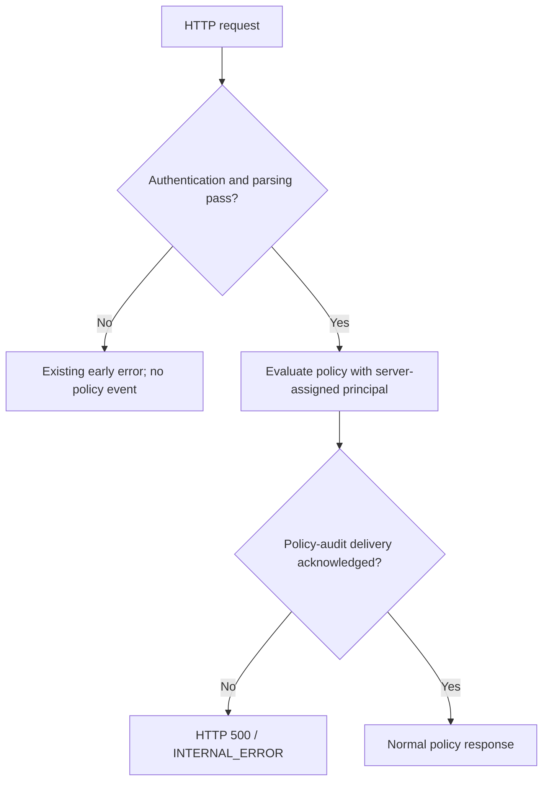
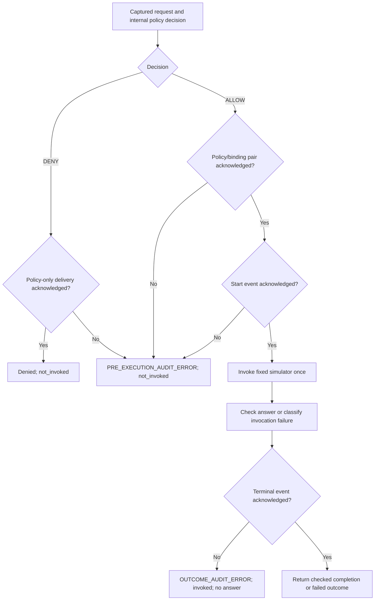

# Architecture and trust boundaries

This guide describes the implemented local service and fixed synthetic
simulator. Detailed contracts and operating instructions remain in the
[README](../README.md).

## Entry points

| Entry point | Trusted setup and identity | Behavior |
| --- | --- | --- |
| `gateway.api.create_app()` | Configured Bearer credential; API assigns the fixed principal after authentication | HTTP policy evaluation; audit delivery disabled unless trusted code supplies a sink |
| `gateway.api_startup.create_postgresql_app()` | Configured Bearer credential and PostgreSQL connection settings | Same non-executing HTTP API, with required policy-audit delivery |
| `gateway.simulator_execution.create_simulator_executor(conninfo)` | Trusted connection settings and separately supplied principal | Explicit Python execution of the fixed synthetic simulator behind required audit gates |
| `gateway.simulator_evidence.create_simulator_evidence_executor(conninfo)` | Same trusted Python calling context | Calls the audited executor once and packages its returned result with outcome-dependent provenance |

The Python executors do not authenticate credentials. Calling code must
establish identity before supplying principal_id. HTTP authentication maps
the configured credential to reliability-reader; request-body identity
claims do not grant authority.

Requests and simulator responses are untrusted data. Server-owned code
selects policy, receivers, and the fixed fixture_store / READ_ITEM simulator.
Supported synthetic item identifiers are built-in integers from 1 to 1000.
Python request snapshots enforce the existing supported caller and request
shape before execution; unsupported inputs raise validation errors.

Factory creation does not connect to PostgreSQL. Successful startup and
an unauthenticated HTTP response do not establish database readiness,
write permission, schema availability, or durable storage.

## Audited HTTP evaluation

The following diagram applies to the explicitly PostgreSQL-audited startup.
It shows logical control flow, not a single database transaction.
Early authentication, media-type, body, or JSON failures return their
existing errors before policy evaluation and create no policy-decision event.

A normal response is the policy result, or the existing HTTP 422 error
when policy evaluation identifies invalid request content. Required audit
delivery precedes either response. There is no unaudited fallback through
this startup path.

The original create_app startup remains unaudited by default. HTTP policy
responses retain execution_status=not_executed. No HTTP route invokes the
simulator.

See [audited API startup](../README.md#explicit-postgresql-audited-api-startup)
and [optional audit delivery](../README.md#optional-api-audit-delivery).

## Explicit synthetic execution

Only an explicit Python executor call enters this path. The executor captures
fixed request values, generates internal identifiers, and evaluates policy.
It does not accept a caller-supplied decision as execution permission.

The diagram summarizes the principal audit gates after preparation.
Preparation errors and process interruptions can propagate without a result.
Each receiver call owns its own transaction; the complete execution is not
one atomic database transaction.

The ALLOW decision and request binding are inserted together in one
transaction. The start event is delivered separately. Both deliveries must
acknowledge success before invocation.

A correct answer and acknowledged completed terminal are required before
returning completion. For simulator exceptions or invalid answers, the
executor attempts to save a failed terminal event and returns no answer.
Denial attempts policy-only delivery.

Existing policy audit records retain not_executed even when this separate
Python path invokes the simulator. Execution events and execution results
describe simulation activity; the policy record is not rewritten.

See [synthetic execution](../README.md#explicit-synthetic-simulator-execution)
and [execution-event receiver](../README.md#postgresql-execution-event-receiver).

## Evidence packaging after execution

The evidence wrapper captures request values and calls the existing executor
once using fresh captured dictionaries. It validates the returned result
against the same expected item.

Completed results require matching synthetic provenance. Failed and denied
results contain no answer or provenance and require no observation-clock read.
The observation timestamp is generated after the returned result is checked;
it is not invocation time, retrieval time, or proof of freshness.

An ordinary post-return validation or packaging failure raises
SimulatorEvidenceError and returns no fallback answer. Its correlation
fields come from a validated returned result when available. Otherwise,
identifiers are None and invocation_status is unknown.

Packaging failure cannot undo invocation or committed records. An underlying
completion diagnostic does not establish envelope preparation or delivery.
Provenance remains unsigned, synthetic, and unpersisted. Fingerprints and
validation establish consistency, not authentic origin or real-world truth.

See [evidence composition](../README.md#opt-in-simulator-execution-with-evidence)
and [packaging-error reconciliation](../README.md#handle-evidence-packaging-errors).

## Storage, diagnostics, and uncertainty

Database constraints enforce their declared formats, references, and uniqueness.
They do not establish every cross-record execution relationship.
The execution receiver adds relationship checks while holding a cooperative
attempt lock. Direct SQL writers can bypass receiver-only checks.

Required PostgreSQL acknowledgements are execution checkpoints. Diagnostic
logs are supplementary troubleshooting notes and never replace them.
Ordinary diagnostic failures are suppressed; BaseException interruptions
can still stop processing.

A failed delivery can follow a successful commit when acknowledgement is
lost or connection close fails. A start without a terminal record does not
establish whether invocation occurred. Missing records or identifiers do not
authorize guessing, automatic retry, record repair, or answer reconstruction.

Use [manual read-only reconciliation](../README.md#manual-reconciliation-of-a-synthetic-attempt).
Timeout settings do not establish a total deadline, and storage configuration
determines power-loss durability. No exactly-once execution guarantee is made.

## Current limits

This architecture provides no operational tool integration, human-approval
lifecycle, replay prevention, or HTTP execution route. Synthetic reads have
their own explicitly limited scope; they grant no authority for real tools.
These contracts and passing tests do not establish production readiness.
